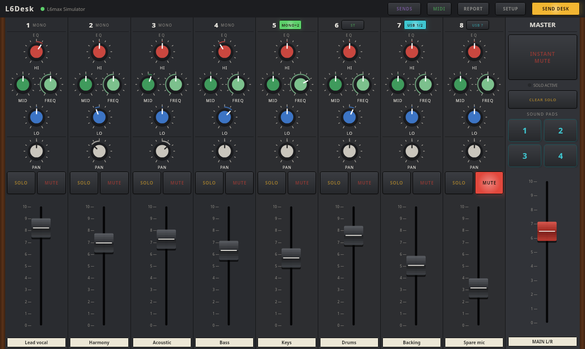

# L6Desk

A remote control for the **Zoom LiveTrak L6max** mixer. Mix from a tablet on a stand, or from a
computer, with the mixer tucked away at the side of the stage.

**[Download the latest release](https://github.com/l6desk/l6desk/releases/latest)**. Each release
has a README, installation instructions (INSTALL.md) and a user guide (USER-GUIDE.md) alongside the
files:

| File | What it is |
|---|---|
| `l6desk_<version>-1_amd64.deb` | The desktop app for Ubuntu (64-bit PC) |
| `l6desk-<version>.apk` | The Android app (tablets, Android 7.0 or newer) |
| `l6desk-bridge-<version>-pi.tar.gz` | The Wi-Fi bridge for a Raspberry Pi Zero 2 W |
| `L6Desk-<version>.msi`, `…-windows-portable.zip` | The desktop app for Windows 10/11 (preview) |

L6Desk was called L6max Remote up to version 0.12.

## What it does

- **All 8 channels:** level, pan, three-band EQ with mid frequency, mute, and solo (done by the
  app, because the L6max has none). MONO ×2 on CH5/CH6 and the USB switches on CH7/CH8.
- **Master section:** a master fader that scales every channel, **INSTANT MUTE** for feedback
  emergencies, and the four **sound pads**.
- **SENDS view:** AUX 1, AUX 2, SUB MIX and EFX sends on the faders, the effect type,
  the compressor, and four **scenes** you can store and recall.
- **Music player:** backing tracks, walk-on and interval music played into CH7 or CH8, in
  playlists you upload from the app: from the Pi bridge, or from the computer or tablet the L6max
  is plugged into.
- **The mixer's memory card:** set the sound pads' sounds, and download the L6max's recordings
  (the master, the tracks with sound, or everything; 24-bit or 32-bit float; normalised if you
  like), from a computer or through the Pi.
- **Two ways to reach the mixer:** a USB cable (from a computer, or a tablet with USB-C), or Wi-Fi
  through a small Raspberry Pi plugged into the mixer. The Pi can run its own Wi-Fi network, so no
  venue Wi-Fi is needed.

## Status

- **Tested with a real L6max** on Ubuntu (USB, and Wi-Fi through the Pi bridge) and on a Samsung
  Galaxy Tab A11 (Android 16: through the Pi, and with a USB-C cable straight into the mixer).
- **Windows (preview, from 0.16):** `L6Desk-<version>.msi` or a portable zip. Mixing over USB and
  the Pi bridge work (tested on Windows 11); the music player works through the Pi, not yet with
  the L6max on the computer's USB. See the release notes for the driver and cable.
- Bluetooth MIDI isn't available yet.

## Questions and problems

Please use [Issues](https://github.com/l6desk/l6desk/issues). From version 0.14, the app's
**REPORT** button makes a problem report for you: a zip file with a screenshot and the details we
need, and a link that opens a new issue already filled in. Drag the zip onto the issue.

Reports are only opened after a check: they must hold exactly the files the app makes, and be
signed by the copy of the app that made them. Please attach only zips made by the app.

## Open source, licence and donations

L6Desk is intended to become an **open source** project, once the app has been tested with
cable (USB), Wi-Fi and Bluetooth connections from both Linux and Android. The licence is likely to
be the **GNU General Public License v3 (GPL-3.0)**, so that it stays fully open. Until then, this
repository holds the releases only.

It's free. If you find it useful, the authors would only ask that you make a donation to a
charity of your own choice. There's no obligation.

## Trademarks

Zoom, LiveTrak and L6max are trademarks of Zoom Corporation. L6Desk is an independent
project. It isn't made, endorsed or supported by Zoom Corporation; the names are used only to say
which mixer it works with. Raspberry Pi is a trademark of Raspberry Pi Ltd. Android is a
trademark of Google LLC.
