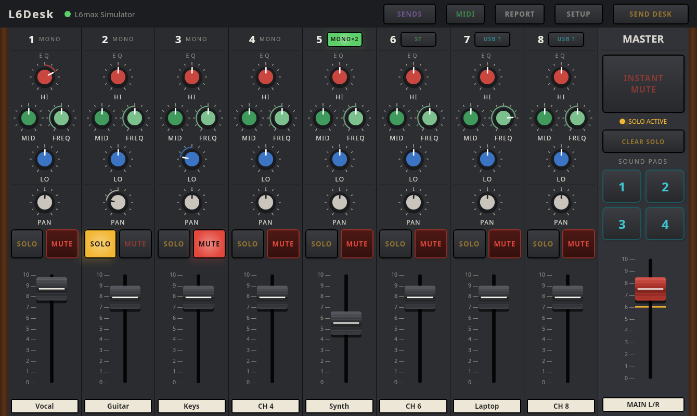
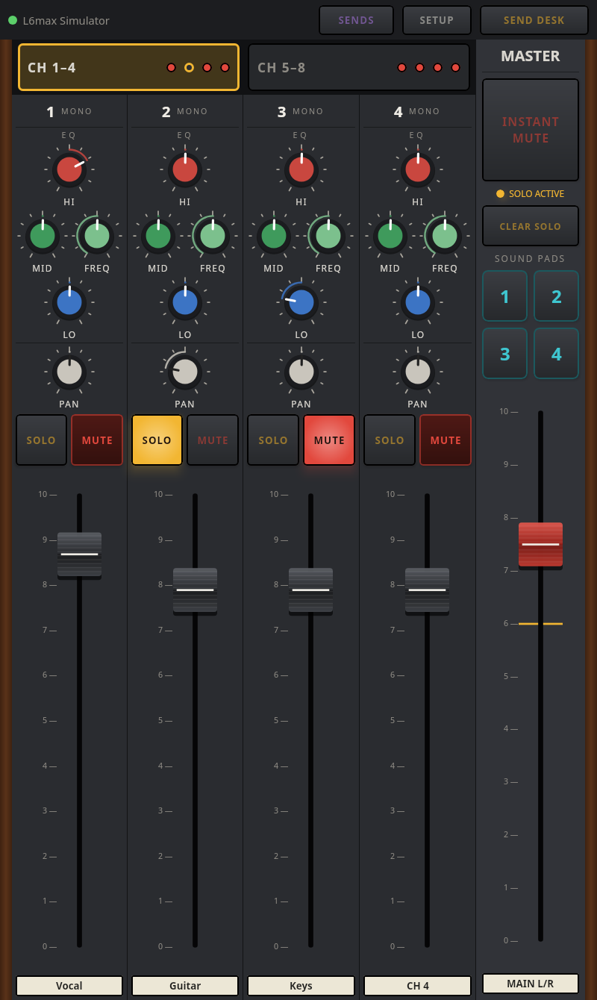
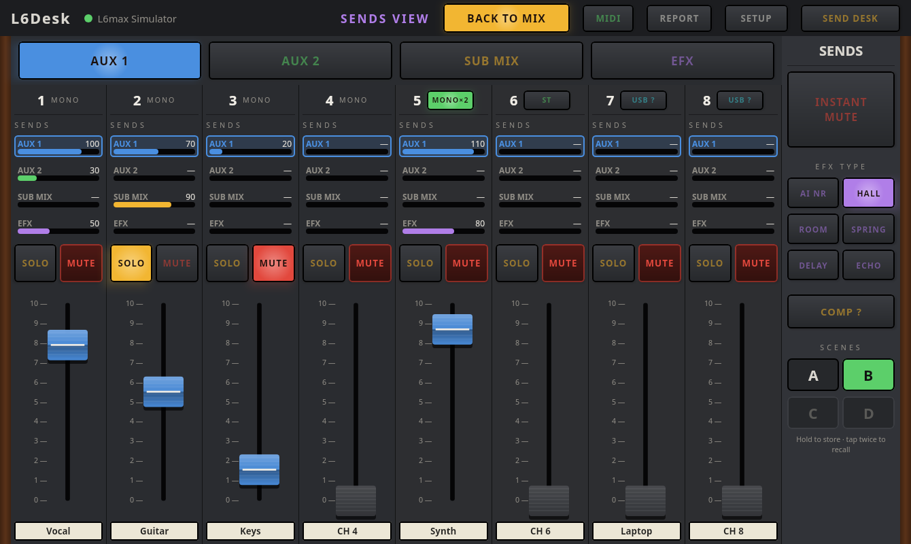
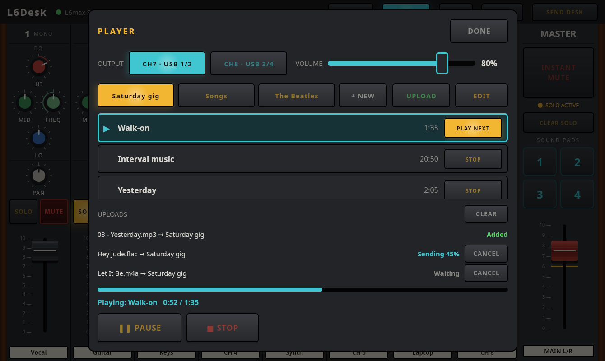
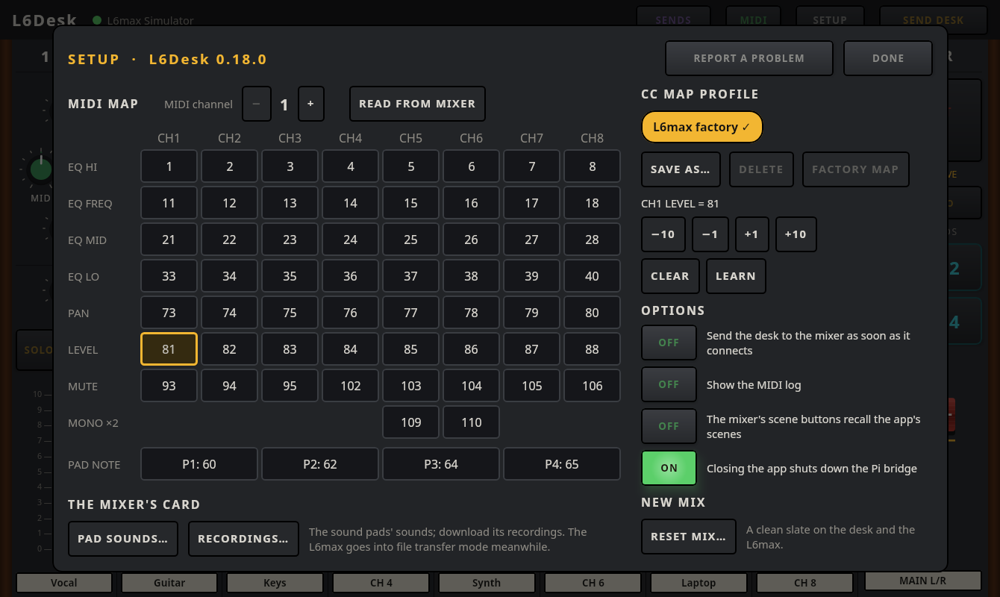
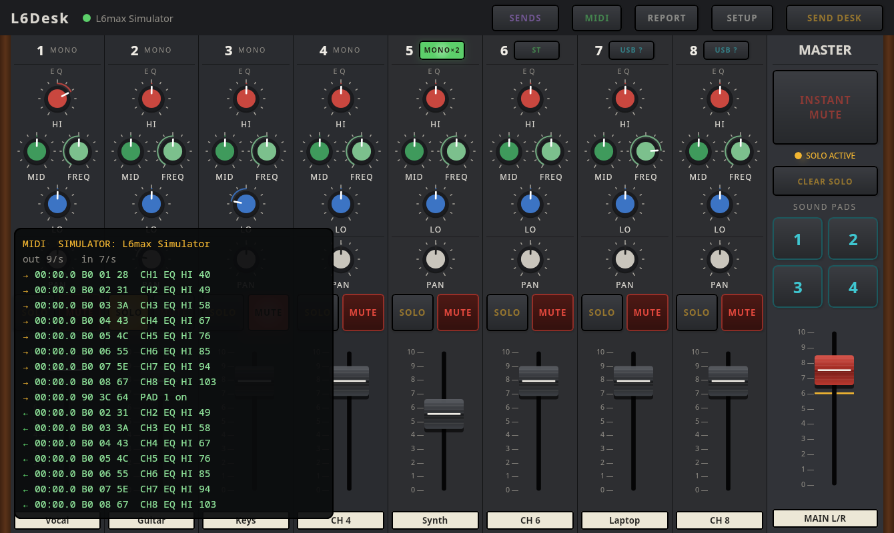
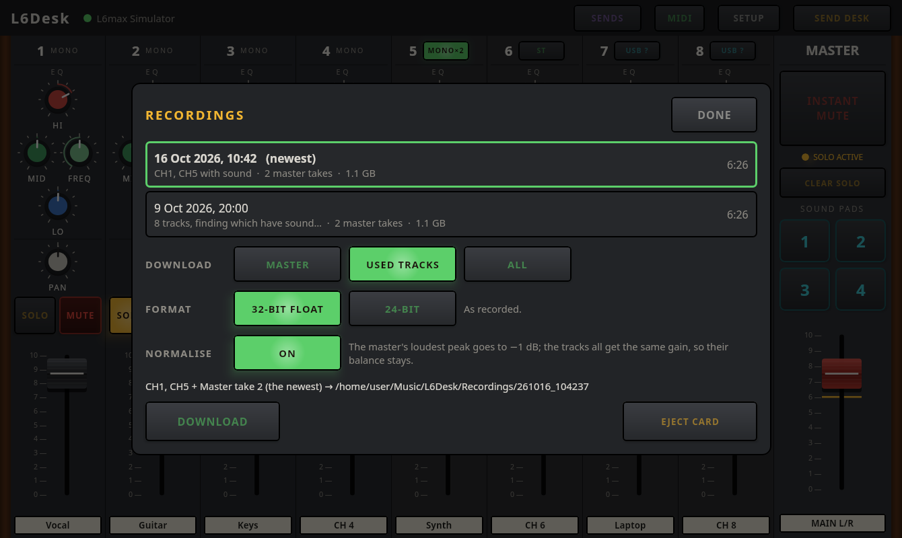
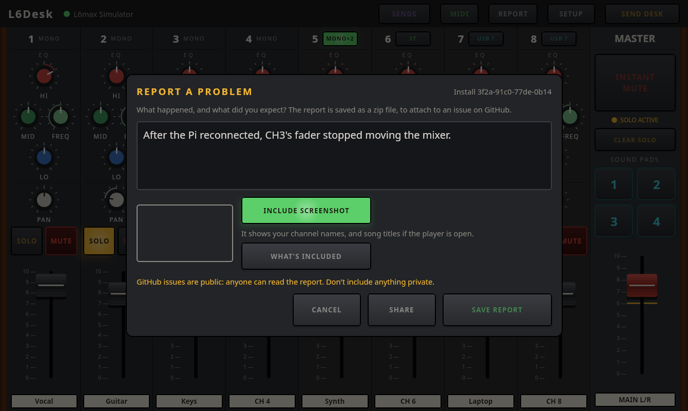

# L6Desk {{VERSION}}: user guide

L6Desk controls a Zoom LiveTrak L6max over MIDI. It looks like the mixer: eight channel
strips, then the master section on the right. The same app runs on a tablet and on a computer.

## Contents

1. [Connecting](#1-connecting)
2. [Two things to know first](#2-two-things-to-know-first)
3. [The channel strips](#3-the-channel-strips)
4. [The master section](#4-the-master-section)
5. [The SENDS view and scenes](#5-the-sends-view-and-scenes)
6. [The music player](#6-the-music-player)
7. [SETUP](#7-setup)
8. [At a gig](#8-at-a-gig)
9. [Troubleshooting](#9-troubleshooting)

## 1. Connecting

The **top bar** shows the connection: a green dot and the device's name when connected. Tap it
to open the **CONNECTION** panel, which lists everything the app can connect to:

- **L6max Mixer Control Port**: the mixer on USB, marked *MIXER CONTROL*: plugged into a computer,
  or into the tablet with a USB-C cable (0.17 or newer; no Pi needed). The L6max has three USB MIDI
  ports; the other two are marked *WRONG PORT*.
- **L6Desk Bridge**: a Pi bridge found on this Wi-Fi network.
- **Bridges you added by address**: type the address (e.g. `10.42.0.1`) and press ADD BRIDGE.
  REMOVE takes one off the list.
- **L6max Simulator**: a pretend mixer inside the app, for trying things out.

The app connects by itself: to the L6max on USB if it's plugged in, otherwise to a bridge it has
found, otherwise to the simulator. Once you pick something, it sticks with that and reconnects to
it whenever it reappears (also after a restart). If the Wi-Fi link drops, the app says so within
about 5 seconds and keeps trying to reconnect.

Only one device can control the mixer through a bridge at a time. A second one is told who's in
control.

A bridge can have a **PIN**, so a stray phone on its network can't take over the desk. The first
time you connect, the app asks for it (BRIDGE PIN) and then remembers it for that bridge; if it's
wrong, it says so and asks again. CANCEL stops connecting. The PIN is set on the Pi (INSTALL.md),
or in SETUP → OPTIONS on a computer in Bridge mode.

## 2. Two things to know first

**SEND DESK.** The L6max can't tell the app how its controls are set. So when the app starts,
it shows the desk as you last left it, and **SEND DESK** in the top bar lights amber. Press it
to make the mixer match the app. Until you do, moving a control sends only that control, so
the rest of the mixer stays as it was. SEND DESK also lights after a reconnect, in case the mixer
was changed meanwhile. To send automatically on connect, see SETUP → OPTIONS.

**INSTANT MUTE.** The big red button at the top of the master section mutes all eight
channels at once, for feedback or any emergency. While it's on, the desk has a flashing red frame.
Press it again and every channel goes back to exactly how it was. It doesn't silence the sound
pads (the mixer plays those separately), so the pads' label turns red as a reminder.

Controls moved on the mixer itself show up in the app straight away, and the other way round.

## 3. The channel strips

From the top of each strip:

- **Number and name.** Tap the name to rename the channel (up to 12 characters).
- **MONO×2** (CH5 and CH6): the channel takes two mono sources instead of one stereo source.
- **USB 1/2** (CH7) and **USB 3/4** (CH8): the channel plays audio from USB (the music player
  or a computer) instead of its own input sockets. Shows *USB ?* until the app knows how it's
  set; tap to set it.
- **EQ**: HI, MID, FREQ (the mid band's frequency) and LO.
- **PAN**.
- **SOLO** and **MUTE**.
- **The fader**: the channel's level.

**Holding the tablet upright (portrait):** the strips come in two banks, **CH 1–4** and **CH 5–8**,
with longer faders. Tap a bank button to switch. Each button has a small lamp per channel, red while
it's muted (by its own MUTE, a solo or INSTANT MUTE) and ringed in amber while it's soloed, so you
can see the other bank at a glance. The master section stays at the side. The MIDI button moves to
SETUP → OPTIONS. To keep the tablet in landscape, lock its rotation (Android's quick settings).

**Knobs and faders:** drag up or down (knobs too: no need to go round in a circle). **Double-tap**
one to reset it: EQ to flat, pan to centre, a fader to its default. On a computer, hold **Shift**
while dragging for fine adjustment. Touching a fader never makes it jump; it moves from where it is.

**Solo** is done by the app (the L6max has no solo). Soloing a channel mutes all the others **in
the main mix**, so the audience hears only the soloed channels. It's not a headphone solo. Several
channels can be soloed at once. Channels muted by a solo are marked differently from ones you
muted yourself, and your own mutes stay on when the solo ends.

## 4. The master section

- **INSTANT MUTE**: see section 2.
- **SOLO ACTIVE** lights while any channel is soloed; **CLEAR SOLO** releases them all.
- **SOUND PADS 1–4**: they play the mixer's sound pads, like pressing them on the mixer: the sound
  plays while your finger is down, or starts and stops, depending on each pad's play mode, which
  is set on the L6max. A pad lights while it's pressed, in the app or on the mixer. A pad in
  **One-shot** mode can't be stopped from the app, so use Loop or Hold for anything you may
  need to stop.
- **The master fader** turns every channel up or down together. **6 is normal** (marked in amber):
  the channels get exactly their own fader levels. Below 6 everything is turned down, above 6
  boosted. Double-tap it to return to 6. The L6max's own MASTER knob still works after this.

## 5. The SENDS view and scenes

**SENDS** in the top bar opens the SENDS view. The main desk stays exactly as it was;
**BACK TO MIX** returns to it.

- The band at the top picks which send the faders set: **AUX 1**, **AUX 2**, **SUB MIX** or
  **EFX**. The fader caps take that send's colour.
- Each strip shows all four send levels; tap one to pick that send.
- The mixer can't report its sends, so a send shows *—* (and a grey fader) until you set it in
  the app or move it on the mixer. The app never sends a send it doesn't know, so pressing SEND
  DESK can't wipe out a monitor mix.
- **EFX TYPE** picks the effect: AI NR, Hall, Room, Spring, Delay or Echo. **COMP** switches the
  compressor (*COMP ?* until known).
- **INSTANT MUTE** is here too.

**Scenes A–D** store the whole desk: levels, pan, EQ, mutes, MONO×2, USB switches, master,
effect, compressor and the sends the app knows. They don't store channel names, solos or
instant mute.

- **Store:** press and **hold** a scene button (about 0.7 seconds).
- **Recall:** **tap twice**. The first tap makes it flash, the second (within 3 seconds) recalls
  it and sends it to the mixer. One stray tap can't change the mix mid-song.

These are the app's scenes, not the scenes stored in the L6max itself. If someone recalls one of
the mixer's own scenes on the mixer, an amber banner warns that the desk no longer matches; press
SEND DESK to put the app's desk back on the mixer, or DISMISS. There's an option in SETUP for the
mixer's scene buttons to recall the app's scenes instead.

## 6. The music player

The music player plays songs into the L6max over USB: **USB 1/2 is heard on CH7, USB 3/4 on
CH8**. It works in two ways:

- **With the Pi bridge:** the songs are stored on the Pi and play from its own card, so a Wi-Fi
  hiccup can't interrupt a song; the app only sends play, stop and so on.
- **On a computer with the L6max plugged in by USB** (0.16 or newer): the songs are stored on the
  computer, in the **L6Desk** folder in your Music folder (`~/Music/L6Desk`; each playlist is a
  folder in it), and play from there. UPLOAD copies songs into it; you can also copy WAV files
  into a playlist folder yourself. To add MP3, AAC or FLAC files, the computer needs ffmpeg
  (`sudo apt install ffmpeg`); without it, only WAV files can be added.
- **On a tablet with the L6max plugged in by USB-C** (0.17 or newer): the songs are stored on the
  tablet, in the app's own folder, and play straight into the L6max. Add them with UPLOAD (the
  tablet converts MP3, AAC and FLAC itself). Uninstalling the app deletes them.

**PLAYER** in the top bar opens it. While a song plays, the top bar shows it with the time left
(tap that to open the player).

### Playing

- **Tap a song to cue it** (amber outline), then press **▶ PLAY**. Tapping alone never starts
  music.
- **PAUSE / RESUME** and **STOP**. A stopped song stays cued, so PLAY starts it again.
- Each song has an **end button**; tap it to change what happens when the song ends:
  - **STOP**: stop, and cue the next song.
  - **PLAY NEXT**: go straight on to the next song, with no gap, until the end of the playlist.
  - **LOOP**: play it again until you press STOP.
- **OUTPUT** picks the channel the player plays on: **CH7 (USB 1/2)** or **CH8 (USB 3/4)**.
- **VOLUME** sets the player's level.

**Opening the player changes nothing on the mixer:** both OUTPUT buttons are off until you choose
one (PLAY asks you to). Choosing a channel notes its level and USB switch, then switches it to USB
at **full level**, and sets the player's volume to 10%, so the VOLUME slider controls the channel
over its whole range: start quiet and bring it up. The other channel is left alone. Choosing the
other channel puts the first back as it was. Closing the player (DONE) puts the chosen channel
back too: its level, and its own inputs if it was on them. If a song is still playing, that waits
until it stops, so closing the panel never changes the level mid-song.

If the chosen channel has been switched back to its own inputs on the mixer since, PLAY asks:
**SWITCH TO USB & PLAY** switches it again; **PLAY ANYWAY** doesn't.

### Playlists and uploading

- The buttons along the top are your **playlists**; tap one to show its songs. **+ NEW** makes a
  new one. When there are more than fit, the row shows a few (always including the one shown),
  and **ALL** lists every playlist, with + NEW there. Long names are cut short in the row; ALL
  shows them in full.
- **UPLOAD** adds songs to the end of the playlist shown. On a computer it opens a file window
  (you can pick several files); on a tablet, Android's file picker.
- **WAV, MP3, AAC (.m4a) and FLAC** files. They're converted for playback when they arrive (by
  the Pi, the computer or the tablet), so MP3 and FLAC take a little longer to appear. Songs bought with copy protection can't be
  converted.
- Each upload shows *Sending %*, then *Converting…*, then *Added*. Uploads carry on if you close
  the player; CANCEL stops one, CLEAR tidies the list.
- A track number at the start of a file name (*03 - Yesterday.mp3*) is dropped from the title.
- The desk stays responsive during an upload, but upload at soundcheck rather than mid-song.
- A 4-minute MP3 takes a few seconds over the Pi's Wi-Fi; a 4-minute WAV, up to about half a
  minute.

### Changing the order, renaming, deleting

Press **EDIT**. Each song then has **▲** and **▼** to move it, and **DELETE**: tap DELETE, then
**SURE?** within 3 seconds. To rename a song, tap its title and type over it; Enter (or tapping
elsewhere) saves it, Escape puts the old one back. Its place in the playlist stays the same. While
editing, tapping a song doesn't cue it. Press **EDITING** to finish.

While editing, the playlist shown can also be changed:
- **RENAME** gives it a new name. Its songs, their end settings and the song playing carry on as
  they were.
- **DELETE PLAYLIST** deletes it and all its songs from the Pi: tap it, read the warning (it says
  how many songs go), then tap **SURE? DELETE** within 3 seconds. If one of its songs is playing,
  it stops. This can't be undone.

Neither works while songs are still uploading into that playlist; wait until they're *Added*.
Renaming songs and playlists, and deleting playlists, need the 0.15 Pi bridge or newer.

## 7. SETUP

**SETUP** in the top bar.

### CC MAP PROFILE and MIDI MAP

The app talks to the mixer with MIDI control numbers ("CCs"). The L6max's factory numbers are
built in as the **Factory** profile. If you've changed them in ZOOM L6 Editor, the app needs the
same numbers:

- **READ FROM MIXER** (desktop app, L6max on USB): reads the mixer's numbers into a new profile.
  This is the quickest way.
- **The grid**: tap a cell to change it with the ± buttons or CLEAR. Duplicate numbers are red.
- **LEARN**: pick a cell, press LEARN, then move that control on the mixer. It moves on to the same
  control on the next channel, so you can learn a row quickly. CANCEL LEARN stops.
- **PAD NOTE**: the note each sound pad uses; LEARN by pressing the pad on the mixer.
- **MIDI channel**: the L6max's MIDI channel (factory setting 1).
- Profiles: SAVE (as a new name), DELETE, and FACTORY MAP. Changing the Factory profile saves a
  copy first.

### OPTIONS

- **Send the desk to the mixer as soon as it connects**: SEND DESK automatically.
- **Show the MIDI log**: the same as the MIDI button in the top bar. It shows the connection and
  the last messages each way, for checking what's happening.
- **The mixer's scene buttons recall the app's scenes**: pressing scene A–D on the mixer recalls
  the app's scene in that slot and sends it. The mixer's own scene plays for a moment first.
  An empty slot shows the warning banner instead.
- **Closing the app shuts down the Pi bridge** (on to start with): when you close the app while
  it's connected to the Pi bridge, it asks: **SHUT DOWN PI & CLOSE**, **CLOSE, LEAVE PI ON** or
  **CANCEL**. Shutting down first is kinder to the Pi's SD card than pulling its power. To start
  the Pi again, unplug its power and plug it back in. On a tablet, closing means going back from
  the desk; swiping the app away in the recent-apps list closes it without asking, and leaves the
  Pi on.
- **Bridge mode** (desktop app): the computer acts as the bridge, so a tablet on the same network
  can control the mixer plugged into this computer. The tablet lists the computer by name, as it
  does the Pi; the line under the option says whether it's announced, and the address to type
  in if not.

### THE MIXER'S CARD: PAD SOUNDS and RECORDINGS

The sound pads' sounds and the L6max's recordings are on its memory card. The app reaches the card
while the L6max is in **file transfer mode**, connected by USB to the computer or to the Pi
bridge:

1. On the L6max, switch on **file transfer mode**. While it's on, the mixer doesn't mix or record,
   so do this before or after the show.
2. Keep (or put) the L6max on USB: to the computer, or to the Pi. The card appears in the panel by
   itself. (Through the Pi, the Pi's bridge needs to be 0.17 or newer.)
3. When you've finished: **EJECT CARD**, *then* switch off file transfer mode on the L6max.
   Switching it off first can lose what was just written.

**PAD SOUNDS…** shows each pad's current sound.

- **CHOOSE…** next to a pad picks a sound for it. On a computer, from a file window (WAV, or MP3,
  AAC or FLAC if ffmpeg is installed). Through the Pi, from the songs in the Pi's music player:
  upload the sound there first (PLAYER → UPLOAD). A pad plays the whole file, so a short sound
  works best.
- **REMOVE** (tap twice) clears a pad.
- Whatever a pad had before is first copied to a backup (`~/Music/L6Desk/Pad backups` on a
  computer, the `.pad-backups` folder in the Pi's music folder), so a sound recorded on the mixer
  is never lost.
- How each pad plays (one-shot, loop, hold) is still set on the L6max.

**RECORDINGS…** downloads what the L6max recorded. Its recordings are listed newest first, with
the newest picked; each shows when it was made, how long it is, which tracks have sound, and how
many master takes it has (one more for each bounce). Tap another to pick it. Then choose:

- **DOWNLOAD:** **MASTER** (the newest master take, i.e. your last bounce), **USED TRACKS** (the
  tracks with sound, plus that master: the L6max records every track, used or not), or **ALL**.
- **FORMAT:** **32-BIT FLOAT** (exactly as recorded) or **24-BIT** (a quarter smaller). The L6max
  records in 32-bit float, so a track can go over full scale without being clipped; 24-bit can't
  hold that, and the app says so if it had to clip anything. NORMALISE avoids it.
- **NORMALISE:** the master's loudest peak goes to −1 dB; the tracks all get the same change, from
  the loudest one, so their balance stays.

The app remembers these choices. DOWNLOAD shows its progress (CANCEL stops it) and saves the
files in `~/Music/L6Desk/Recordings/<recording>` on a computer, or the tablet's
`Music/L6Desk/Recordings/<recording>` (the tablet keeps the WAV files, not the mixer's project
file). OPEN FOLDER opens it (computer). Nothing on the card is changed or deleted.

Through the Pi, the files come over its Wi-Fi at about 2–3 MB a second: a master takes about a
minute for every 7 minutes recorded, and normalising first reads the files (the first time only).
The panel gives an estimate. Whole multitracks are quicker downloaded with the L6max on a
computer's USB.

### NEW MIX

**RESET MIX** gives a clean slate for a new mix (the L6max starts up exactly as it was switched
off): every level to 0, pan centre, EQ flat, effect sends to 0, mutes and solos off, master to 6.
It keeps channel names, MONO×2, the USB switches and the AUX and SUB MIX sends. It asks you to
confirm, and only works while connected.

## 8. At a gig

- **Before the show:** connect, press SEND DESK (or RESET MIX for a fresh start), check the
  player's songs are there, and choose its output (CH7 or CH8).
- **Do your uploads and playlist changes at soundcheck.**
- **Keep the tablet on the Pi's own Wi-Fi network**, not the venue's.
- **INSTANT MUTE** is always in the master section, in both views.
- The screen stays on while connected (tablet).
- The app saves the desk as you go, so a restart picks up where you were. Solo and instant mute
  always start off.

## 9. Troubleshooting

| What you see | What to do |
|---|---|
| The app connects to the **simulator**, not the mixer | Tap the connection status and pick the L6max (USB) or the bridge. Check the USB cable carries data. |
| The tablet doesn't find the bridge | Check the tablet is on the Pi's network. Add the bridge by address: 10.42.0.1 on the Pi's own network. |
| *Bridge … is busy* | Another device is in control; close the app there. |
| *Bridge … needs updating* | The Pi has an older bridge than the app. Update it (INSTALL.md). |
| The mixer doesn't match the app | Press SEND DESK. |
| Moving controls on the mixer doesn't move them in the app | Check the MIDI log. If the numbers differ from the app's, use READ FROM MIXER or LEARN (SETUP). |
| No sound from the player | Choose an OUTPUT (CH7 or CH8) in the player. Check that channel's USB switch (USB 1/2 / USB 3/4), its mute, and that the player's VOLUME isn't at 0. |
| A hum or buzz on CH7 or CH8 | An unused channel turned right up. The player only raises the channel you choose; turn the other one down. |
| PAD SOUNDS or RECORDINGS keeps saying *Looking for the card…* | Check file transfer mode is on and the L6max is on USB (to this computer, or to the Pi). On Ubuntu, unplug and replug it once. |
| RECORDINGS says the bridge *is too old* or *isn't set up for the mixer's card* | Update the Pi bridge to 0.17 or newer (INSTALL.md); the install adds what it needs. |
| Player sound crackles or drops out on the Pi | See "Looking after it" in INSTALL.md. |
| A red or amber **UNDER-VOLTAGE** banner | The Pi's power supply is (red) or was (amber) too weak, which can drop the link or a song, or restart the Pi. Use a 5 V 2.5 A supply and a short, thick cable. DISMISS hides it until the next dip. |
| *The Pi is hot* | It slows itself down above about 80 °C. Give it air: out of the sun, away from amplifiers, out of a closed box. |
| *The Pi has only … MB left for songs* | Uploads may fail. Delete songs or playlists you don't need (PLAYER → EDIT). |
| Several warnings | They're shown one at a time ("1 of 3"); DISMISS moves on to the next. |
| A sound pad won't stop | It's in One-shot mode; change the pad to Loop or Hold on the L6max. |

### Reporting a problem

Press **REPORT** in the top bar, or **REPORT A PROBLEM** in SETUP. The app takes a picture of the
screen as it is, then asks what happened.

1. Describe what happened and what you expected.
2. Untick **INCLUDE SCREENSHOT** if you'd rather not send it: it shows your channel names, and song
   titles if the player is open. **WHAT'S INCLUDED** shows everything else that goes in: the app's
   version, the computer or tablet, the connection, and the last few minutes of connection events
   and MIDI messages. Home network addresses are left out.
3. **SAVE REPORT** saves it as a zip file (`l6desk-report-….zip`). On a tablet, **SHARE** sends it
   to another app instead, such as email or Drive.
4. **OPEN GITHUB ISSUE** opens a new issue on github.com/l6desk/l6desk, already filled in. Drag
   the zip file onto it and submit. You'll need a free GitHub account.

GitHub issues are public, so don't include anything private. Each report is signed by your copy of
the app, so the people looking into it can tell it hasn't been changed since it was made, and
which reports came from the same app.
